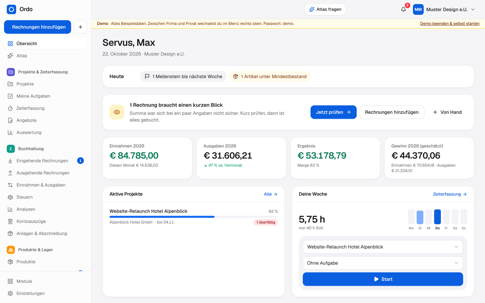
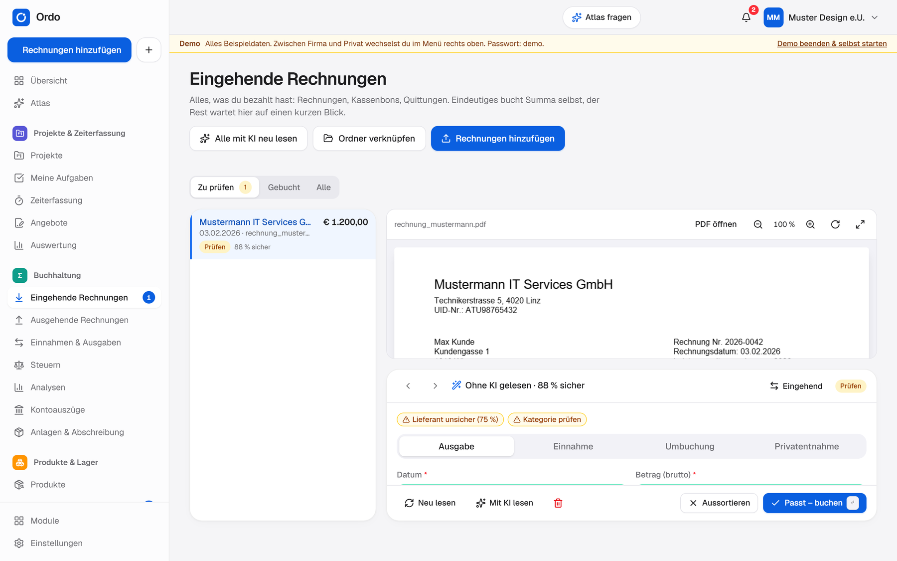
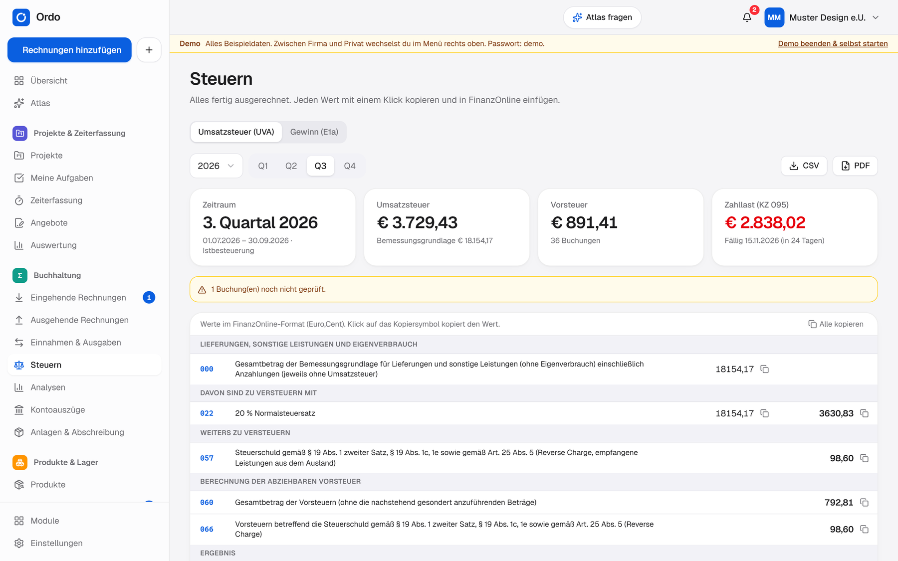
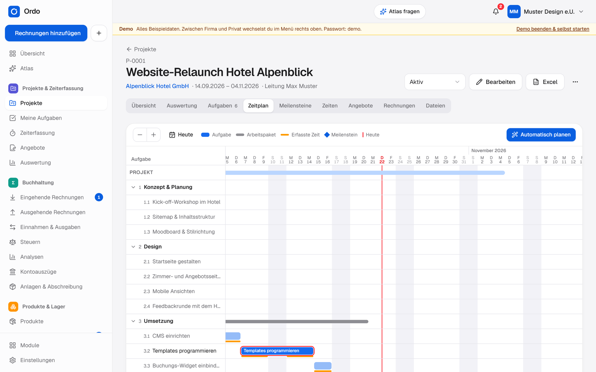
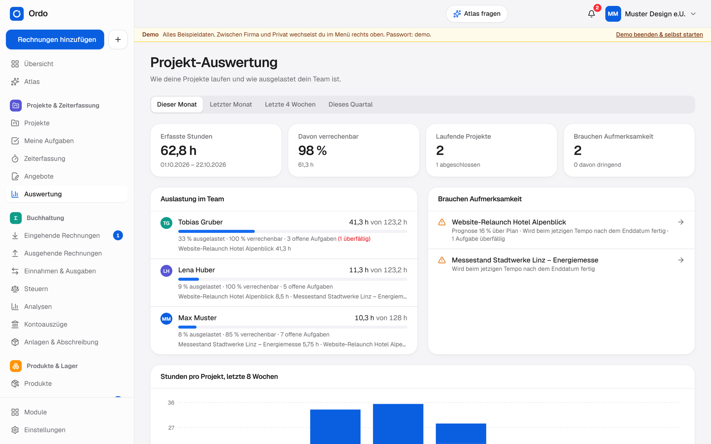
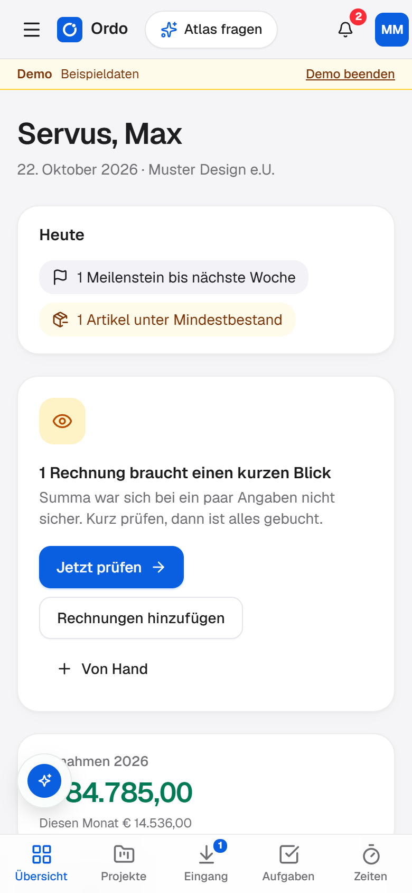

<p align="center">
  
</p>

<h1 align="center">Ordo</h1>

<p align="center">
  <strong>Buchhaltung, Projekte und Lager für Selbstständige und kleine Firmen.</strong><br />
  Deine Installation. Deine Datenbank. Freie Software unter GNU AGPL-3.0.
</p>

<p align="center">
  <a href="#schnell-starten">Selbst starten</a> ·
  <a href="../../releases">Community-Releases</a> ·
  <a href="SELFHOST.md">Eigene Datenbank</a> ·
  <a href="docs/API.md">Schnittstellen</a> ·
  <a href="https://ordo-app.at">Website</a>
</p>

<p align="center">
  
</p>

*Ordo is local-first business software for sole traders and small companies – bookkeeping with (Austrian) VAT returns, projects and time tracking, stock and production, and the AI assistant Atlas. The interface is German. This is the open-source edition under the GNU AGPL-3.0: run it entirely on your own device or with your own database.*

**Dieses Repository ist die eigenständige Open-Source-Ausgabe.** Es enthält keinen Zugang zu einer privaten Betreiber-Datenbank. Du entscheidest: lokal ohne Konto, mit deinem eigenen Supabase-Projekt oder vollständig auf deiner eigenen Infrastruktur. Öffentliche Betreiberkonten, Wartelisten und Bezahlangebote gehören nicht zu dieser Ausgabe.

| Lokal verwenden | Eigene Datenbank | Selbst hosten |
| --- | --- | --- |
| Verschlüsselter Tresor auf deinem Gerät, ohne Konto | Geräteabgleich über dein eigenes Supabase-Projekt | Web-App und Supabase auf deiner Infrastruktur |
| [Schnell starten](#schnell-starten) | [Projekt verbinden](SELFHOST.md#a-eigenes-projekt-bei-supabase) | [Docker und Betrieb](SELFHOST.md#c-die-web-app-selbst-hosten) |

---

## Was Ordo macht

Ordo nimmt dir die Routine vor der Steuerberatung ab: Rechnungen sammeln, Zahlen erfassen, Fristen im Blick behalten. Es ersetzt weder deine Kanzlei noch jedes Programm, das du schon hast – es arbeitet mit ihnen zusammen.

<table>
  <tr>
    <td width="50%" valign="top">
      <br />
      <strong>Rechnungen rein, Buchung raus.</strong> Ordo liest PDFs, Fotos, E-Rechnungen und den QR-Code am Kassabon. Eindeutiges bucht sich selbst, nur Unsicheres wartet auf einen kurzen Blick.
    </td>
    <td width="50%" valign="top">
      <br />
      <strong>Steuern, fertig ausgerechnet.</strong> UVA (U 30), E 1a und L 1 rechnen laufend mit. Jede Kennzahl hat einen Kopierknopf für FinanzOnline, dazu der BMD-Export für die Kanzlei.
    </td>
  </tr>
  <tr>
    <td width="50%" valign="top">
      <br />
      <strong>Projekte und Zeiten.</strong> Arbeitspakete und Aufgaben als Baum, Board oder Zeitplan, Meilensteine, Stoppuhr und Angebote, die mit einem Klick zur Rechnung werden.
    </td>
    <td width="50%" valign="top">
      <br />
      <strong>Auswertung für die Projektleitung.</strong> Ist gegen Plan, Prognose und voraussichtliches Ende pro Projekt, Auslastung im Team und die Projekte, die gerade Aufmerksamkeit brauchen.
    </td>
  </tr>
</table>



### Alle Module

- **Summa – Buchhaltung** (immer dabei): eingehende Rechnungen lesen und buchen, ausgehende Rechnungen schreiben oder aus dem bisherigen Programm einlesen, Kontoauszüge abgleichen (George, ELBA, Bank Austria, N26, Revolut, PayPal, CAMT.053), UVA, E 1a, L 1, doppelte Buchführung mit Einheitskontenrahmen, Anlagen mit Abschreibung.
- **Projekte & Zeiterfassung:** Projekte mit Budget, Arbeitspakete, Meilensteine, Zeitplan, Stoppuhr, Angebote mit PDF, Auswertung mit Prognose und Team-Auslastung.
- **Produkte & Lager:** Artikel, Bestand, Mindestbestand, Inventur, Lagerwert.
- **Produktion:** Stücklisten, Arbeitsschritte, Fertigungsaufträge, Fertigware geht ins Lager.
- **Atlas:** der Assistent in Ordo. Beantwortet Fragen mit deinen Zahlen, zeichnet Diagramme und erledigt Dinge wie Zeiten erfassen – mit deinem eigenen API-Key von Anthropic oder OpenAI oder in der Desktop-App mit deinem ChatGPT-Abo über Codex. Fragt direkt vor Ort nach deiner Einwilligung und zeigt laufende Arbeit samt betroffenem Bereich. Aus, bis du ihn einschaltest.
- **Schnittstellen:** BMD, ebInterface, E-Rechnung (XRechnung, ZUGFeRD, PEPPOL), SAP Business One, REST, Webhooks und eine lokale Schnittstelle für andere Programme am selben Computer ([docs/API.md](docs/API.md)).

Am Handy läuft Ordo als App vom Home-Bildschirm, mit Kamera für Kassabons.

<br clear="right" />

## Was diese Ausgabe ausmacht

- **Kein Betreiber dazwischen.** Es ist kein Server vorkonfiguriert. Ordo läuft entweder **ohne Konto** (alles bleibt verschlüsselt auf dem Gerät) oder mit **deiner eigenen Datenbank** (ein Supabase-Projekt, gratis oder selbst betrieben). Dann gleichen alle deine Geräte und dein Team darüber ab, samt Einstellungen und Verbindungen. Anleitung: [SELFHOST.md](SELFHOST.md).
- **Verschlüsselt.** Der Tresor wird mit deinem Passwort verschlüsselt (Argon2id, AES-256-GCM), bevor er das Gerät verlässt. Details: [docs/SECURITY.md](docs/SECURITY.md).
- **Keine Telemetrie.** Kein Tracking, keine Analyse, keine Werbung. Daten gehen nur dorthin, wo du sie selbst hinschickst: deine Datenbank, dein KI-Anbieter, deine Schnittstellen.
- Nicht enthalten sind die Teile des gehosteten Ordo, die nur für dessen Betrieb da sind: Admin-Bereich, Umfragen, Rückmeldungen an den Betreiber, Bezahlfunktionen und Updates aus dessen Kanal.

## Fertige Apps oder selbst bauen

**Community-Releases:** Verfügbare Installationsdateien stehen unter [Releases](../../releases). Windows- und Mac-Builds werden im öffentlichen Repository aus diesem Quellcode erstellt; ihren Stand siehst du unter [Actions](../../actions). Community-Builds haben eine eigene App-Kennung und enthalten keinen privaten Server oder privaten Updatekanal. Falls für deine Plattform noch kein fertiges Paket vorliegt, kannst du selbst bauen.

**Selbst bauen** aus diesem Quellcode, ganz ohne Ordo-Server:

### Schnell starten

Voraussetzungen: [Node.js](https://nodejs.org) 22 oder neuer und pnpm (`corepack enable`).

```bash
pnpm install
pnpm dev
```

Dann <http://localhost:5174/app/> öffnen und „Demo ansehen“ wählen, um mit einer Beispielfirma durchzuklicken. Unter Windows geht auch ein Doppelklick auf `Start-Ordo.cmd` (Web-App, Desktop-App, Tests).

Für den Abgleich reicht ein beliebiger PostgreSQL-Server allein nicht: Ordo verwendet Supabase mit PostgreSQL, Auth und Storage. Supabase kannst du selbst betreiben oder als eigenes Projekt verbinden.

- **Web-App bauen:** `pnpm build:app` – das Ergebnis liegt in `packages/app/dist` und ist eine statische Seite (App unter `/app/`). Mit Docker: siehe [SELFHOST.md](SELFHOST.md).
- **Desktop-App bauen:** [Rust](https://rustup.rs) installieren, dann `pnpm desktop:build`. Unter Windows liegt der Installer danach in `apps/desktop/src-tauri/target/release/bundle/nsis`, am Mac die App unter `…/bundle/macos`.
- **Tests:** `pnpm test`, Typprüfung: `pnpm typecheck`.

## Aufbau

| Ordner | Inhalt |
| --- | --- |
| `packages/core` | Datenmodell, Verschlüsselung, Buchhaltung, Steuern (UVA, E 1a, L 1), Projekt-Auswertungen, Erkennung, Exporte – ohne UI |
| `packages/app` | Web-App und Oberfläche der Desktop-App (React, Vite) |
| `apps/desktop` | Desktop-App für Windows und Mac (Tauri, Rust): Dateien, Ordnerüberwachung, lokale Schnittstelle, Codex |
| `supabase` | Datenbank-Schema für den Abgleich über deine eigene Datenbank |
| `docs` | Architektur, Sicherheit, Steuern, Schnittstellen |

Mehr dazu in [docs/ARCHITECTURE.md](docs/ARCHITECTURE.md).

## Hinweis

Ordo ist ein Werkzeug zur Vorbereitung – keine Steuerberatung und kein Ersatz für die Prüfung durch Fachleute. Steuerwerte und Formulare entsprechen dem Stand der jeweiligen Version (siehe [docs/STEUERN.md](docs/STEUERN.md)).

## Lizenz

Copyright © 2026 Hellinckx Process Simulation e.U. – <https://ordo-app.at>

Dieses Programm ist freie Software: Du kannst es unter den Bedingungen der **GNU Affero General Public License, Version 3**, weitergeben und verändern ([LICENSE](LICENSE)). Wer eine veränderte Fassung anderen über ein Netzwerk zur Verfügung stellt, muss ihnen auch den geänderten Quellcode zugänglich machen.

Diese Ausgabe erscheint mit jeder Version von Ordo neu.

## Mitmachen

Fehler nachvollziehbar beschreiben, Ideen als Issue diskutieren oder einen Pull Request einreichen. Verwende ausschließlich anonymisierte Beispieldaten und veröffentliche keine Tresore, Zugangsschlüssel oder echten Rechnungen. Einstieg: [CONTRIBUTING.md](CONTRIBUTING.md).
